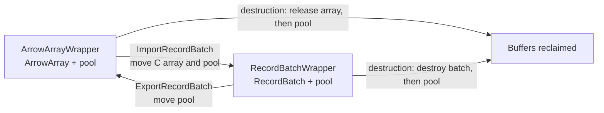

# Arrow Batch Ownership

## Purpose and boundary

`ArrowArrayWrapper` and `RecordBatchWrapper` keep the allocator used for Arrow
buffers alive for as long as those buffers can be released. Both are move-only.
`ArrowArrayWrapper` owns the Arrow C Data Interface representation;
`RecordBatchWrapper` owns the Arrow C++ representation. Conversion transfers
the memory pool with the data, so the source wrapper never releases data that
the destination still uses.

The worker-facing message interfaces continue to pass `interface::ArrowArrayPtr`
and `interface::ArrowSchemaPtr`. `interface::ArrowArrayPtr` is a
`std::unique_ptr<ArrowArrayWrapper>`; it no longer points directly to an
`ArrowArray`. Callers use the wrapper's `array()` accessor when an Arrow C ABI
function needs `ArrowArray*`. `interface::ArrowSchemaPtr` retains its existing
release-aware ownership. The `internal::RecordBatch` value in
`call_message_builder_impl.hpp` continues to hold an `interface::ArrowArrayPtr`
and `is_end_of_group`; its interface does not change.

The wrappers and their conversion methods form an opt-in Arrow C++ bridge.
`Context`, `Call`, message builders, and message views do not expose
`arrow::RecordBatch` or `arrow::MemoryPool` in their methods. The schema and
record-batch sequencing rules remain those in the
[data-stream protocol](../protocol/low_level/data_stream.md).

## Ownership contract

`ArrowArrayWrapper` stores `ArrowArray` by value and an optional
`std::unique_ptr<arrow::MemoryPool>`. An empty pool pointer means there is no
dedicated pool to destroy. Its destructor calls `array_.release(&array_)` if
the callback is present, then destroys the pool. A released or moved-from
array has a null `release` callback. Copying is disabled; moving transfers the
struct contents and pool, and clears the source callback. Move assignment
releases the destination's previous array before replacing its pool.

`RecordBatchWrapper` stores a `std::shared_ptr<arrow::RecordBatch>` and the
same optional pool owner. It exposes the batch as `const arrow::RecordBatch&`,
which is suitable for `arrow::ExportRecordBatch`. The batch is destroyed before
the pool, including during move assignment. A reference returned by either
wrapper remains valid only while that wrapper holds the corresponding value.
Callers do not retain columns, buffers, or other views of the batch beyond the
wrapper's lifetime unless they transfer pool ownership with them.



The following sketch shows the ownership shape and conversion interface. It
omits constructors and move implementations; those preserve the release and
destruction order described above.

```cpp
namespace exasol::udf::v2::interface {

class RecordBatchWrapper;

class ArrowArrayWrapper {
public:
    ArrowArrayWrapper(const ArrowArrayWrapper&) = delete;
    ArrowArrayWrapper(ArrowArrayWrapper&&) noexcept;
    ArrowArrayWrapper& operator=(ArrowArrayWrapper&&) noexcept;
    ~ArrowArrayWrapper(); // release array_ before pool_

    ArrowArray* array() noexcept { return &array_; }
    arrow::Result<RecordBatchWrapper> into_record_batch(
        std::shared_ptr<arrow::Schema> schema) &&;

private:
    std::unique_ptr<arrow::MemoryPool> pool_;
    ArrowArray array_{};
};

using ArrowArrayPtr = std::unique_ptr<ArrowArrayWrapper>;

class RecordBatchWrapper {
public:
    RecordBatchWrapper(const RecordBatchWrapper&) = delete;
    RecordBatchWrapper(RecordBatchWrapper&&) noexcept;
    RecordBatchWrapper& operator=(RecordBatchWrapper&&) noexcept;
    ~RecordBatchWrapper() = default;

    const arrow::RecordBatch& record_batch() const noexcept { return *batch_; }
    arrow::Result<ArrowArrayWrapper> into_arrow_array() &&;

private:
    std::unique_ptr<arrow::MemoryPool> pool_;
    std::shared_ptr<arrow::RecordBatch> batch_; // destroyed before pool_
};

} // namespace exasol::udf::v2::interface
```

## Conversion and failure

For C-to-C++ conversion, the caller imports the direction's `ArrowSchemaPtr`
once and keeps the resulting `std::shared_ptr<arrow::Schema>` for later batches.
`std::move(array_wrapper).into_record_batch(schema)` passes `array()` to
`arrow::ImportRecordBatch`. Arrow moves the C array contents into the resulting
record batch. After success, the source array's `release` is null and the pool
belongs to `RecordBatchWrapper`. Destroying the source cannot release the
imported array or its pool. The schema owner is separate from both wrappers.

For C++-to-C conversion,
`std::move(batch_wrapper).into_arrow_array()` calls
`arrow::ExportRecordBatch(batch_wrapper.record_batch(), destination.array())`.
On success, the pool moves to `ArrowArrayWrapper`; the exported C array retains
the batch data until its release callback runs. The outgoing schema, when
needed, is exported and owned separately as `ArrowSchemaPtr`.

A failed import or export returns an Arrow error. The source retains its pool
until Arrow's operation has finished and any still-owned C array or C++ batch
has been released. A failed import may consume the C array according to Arrow's
C Data Interface contract; cleanup therefore checks the `release` callback
rather than assuming the array remains live. A failed export releases any
partially populated destination array while the source batch and pool still
exist. Neither failure creates two owners for the pool or calls an array's
release callback twice.

`ArrowArrayWrapper::array()` is a borrowed pointer. It is valid only while the
wrapper remains alive and must not be retained across a move or conversion.
`interface::ArrowArrayPtr` keeps the wrapper's address stable when the pointer
itself is moved between message views, builders, and context queues.

The [Arrow C++ C interface](https://arrow.apache.org/docs/cpp/api/c_abi.html)
defines the `ImportRecordBatch` consumption and `ExportRecordBatch` release
contracts used here.
