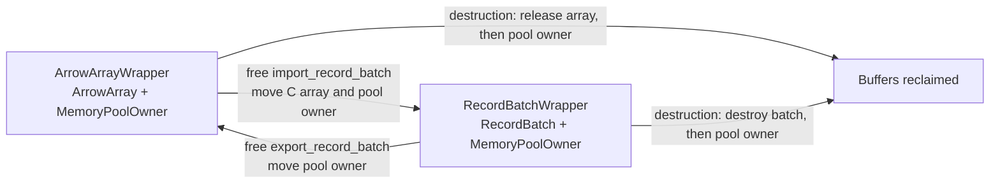

# Arrow Batch Ownership

## Purpose and boundary

This design addresses [issue #117](https://github.com/exasol/udf-runner-cpp/issues/117).

`ArrowArrayWrapper` and `RecordBatchWrapper` keep the allocator used for Arrow
buffers alive until those buffers can be released. Both are move-only.
`ArrowArrayWrapper` owns the Arrow C Data Interface representation;
`RecordBatchWrapper` owns the Arrow C++ representation. Conversion moves the
pool owner with the data, so the source wrapper does not release data still
used by the destination.

Worker-facing message interfaces pass `interface::ArrowArrayWrapper` by value
and `interface::ArrowSchemaPtr` for schemas. `ArrowArrayWrapper::array()` gives
callers a borrowed `ArrowArray*` for C ABI operations. The
`internal::RecordBatch` value in `call_message_builder_impl.hpp` continues to
hold the array and `is_end_of_group` metadata; its array member is an
`ArrowArrayWrapper` value. `interface::ArrowSchemaPtr` retains its existing
release-aware ownership.

`ArrowArrayWrapper` exposes no Arrow C++ types. The opt-in `arrow_bridge`
module owns `RecordBatchWrapper` and provides free functions for C/C++
conversion. `Context`, `Call`, message builders, and message views expose only
project-owned types and the Arrow C Data Interface. Schema and record-batch
sequencing follows the [data-stream protocol](../protocol/low_level/data_stream.md).

## Ownership contract

`ArrowArrayWrapper` stores `ArrowArray` by value and an optional
`std::unique_ptr<MemoryPoolOwner>`. `MemoryPoolOwner` is a project-owned abstract
interface with a virtual destructor. An Arrow-specific implementation owns the
`arrow::MemoryPool` in the bridge module; neither that type nor an Arrow C++
header appears in the core wrapper interface. A null owner is valid only when
the buffers use a pool with an independent, unlimited lifetime.

`ArrowArrayWrapper` calls `array_.release(&array_)` when the callback is present,
then destroys its pool owner. Copying is disabled. Moving transfers the C
struct contents and pool owner and clears the source `release` callback. Move
assignment releases the destination's old array before replacing its old pool
owner. The `ArrowArray*` returned by `array()` is valid only until the wrapper
is moved, converted, or destroyed; callers do not retain it across those
operations. The bridge extracts the pool owner only after Arrow has consumed
the C array. It attaches a pool owner to an exported array only after export
succeeds.

`RecordBatchWrapper` stores a `std::shared_ptr<arrow::RecordBatch>` and the same
optional `MemoryPoolOwner`. It destroys the batch before the pool owner,
including during move assignment. `record_batch()` returns a borrowed
`const arrow::RecordBatch&` suitable for `arrow::ExportRecordBatch`.
The stored batch is non-null while the wrapper holds a value. When a dedicated
pool owner is present, construction transfers the sole batch owner into the
wrapper; no external shared copy may outlive it.
`shared_record_batch()` returns a shared pointer only when the pool owner is
null; otherwise it returns an `arrow::Status::Invalid` error because a shared
batch could outlive its dedicated pool. Callers do not retain columns, buffers,
or other views of a pool-backed batch beyond the wrapper's lifetime.



The following sketch shows the ownership shape and the public conversion
boundary. It omits constructor and move implementations, which preserve the
release and destruction order above. The concrete `MemoryPoolOwner` subclass
that owns `arrow::MemoryPool` is defined only in the bridge implementation.

```cpp
namespace exasol::udf::v2::interface {

class MemoryPoolOwner {
public:
    virtual ~MemoryPoolOwner() = 0;
};
inline MemoryPoolOwner::~MemoryPoolOwner() = default;

class ArrowArrayWrapper {
public:
    ArrowArrayWrapper() = default;
    ArrowArrayWrapper(ArrowArray&& array, std::unique_ptr<MemoryPoolOwner> pool);
    ArrowArrayWrapper(const ArrowArrayWrapper&) = delete;
    ArrowArrayWrapper(ArrowArrayWrapper&&) noexcept;
    ArrowArrayWrapper& operator=(ArrowArrayWrapper&&) noexcept;
    ~ArrowArrayWrapper(); // release array_ before pool_

    ArrowArray* array() noexcept { return &array_; }
    std::unique_ptr<MemoryPoolOwner> take_pool() && noexcept; // requires null release
    void attach_pool(std::unique_ptr<MemoryPoolOwner> pool) noexcept; // requires no pool

private:
    std::unique_ptr<MemoryPoolOwner> pool_;
    ArrowArray array_{};
};

} // namespace exasol::udf::v2::interface

namespace exasol::udf::v2::arrow_bridge {

class RecordBatchWrapper;
arrow::Result<interface::ArrowArrayWrapper> export_record_batch(
    RecordBatchWrapper&& batch);

class RecordBatchWrapper {
public:
    RecordBatchWrapper(std::shared_ptr<arrow::RecordBatch>&& batch,
                       std::unique_ptr<interface::MemoryPoolOwner> pool = {});
    RecordBatchWrapper(const RecordBatchWrapper&) = delete;
    RecordBatchWrapper(RecordBatchWrapper&&) noexcept;
    RecordBatchWrapper& operator=(RecordBatchWrapper&&) noexcept;

    const arrow::RecordBatch& record_batch() const noexcept { return *batch_; }
    arrow::Result<std::shared_ptr<arrow::RecordBatch>> shared_record_batch() const;

private:
    friend arrow::Result<interface::ArrowArrayWrapper> export_record_batch(
        RecordBatchWrapper&& batch);
    std::unique_ptr<interface::MemoryPoolOwner> pool_;
    std::shared_ptr<arrow::RecordBatch> batch_; // destroyed before pool_
};

arrow::Result<RecordBatchWrapper> import_record_batch(
    interface::ArrowArrayWrapper&& array, std::shared_ptr<arrow::Schema> schema);

} // namespace exasol::udf::v2::arrow_bridge
```

## Conversion and failure

The caller imports the direction's `ArrowSchemaPtr` once and keeps the
resulting `std::shared_ptr<arrow::Schema>` for later batches.
`arrow_bridge::import_record_batch(std::move(array), schema)` passes
`array.array()` to `arrow::ImportRecordBatch`. Arrow moves the C array contents
into the resulting record batch. On success, the source array's `release` is
null and its pool owner moves to `RecordBatchWrapper`; destroying the source
cannot release the imported array or pool.

`arrow_bridge::export_record_batch(std::move(batch))` calls
`arrow::ExportRecordBatch(batch.record_batch(), destination.array())`. On
success, the pool owner moves to the returned `ArrowArrayWrapper` through
the bridge's access to `RecordBatchWrapper` and `ArrowArrayWrapper::attach_pool()`.
The exported
C array retains the batch data until its release callback runs. The outgoing
schema, when needed, is exported and owned separately as `ArrowSchemaPtr`.

A failed import or export returns an Arrow error. The source retains its pool
owner until Arrow's operation has finished and any still-owned C array or C++
batch has been released. A failed import may consume the C array; cleanup
checks its `release` callback rather than assuming the array remains live. A
failed export releases any partially populated destination array while the
source batch and pool owner still exist. Neither path creates two pool owners
or calls an array's release callback twice.

The [Arrow C++ C interface](https://arrow.apache.org/docs/cpp/api/c_abi.html)
defines the `ImportRecordBatch` consumption and `ExportRecordBatch` release
contracts used here.
