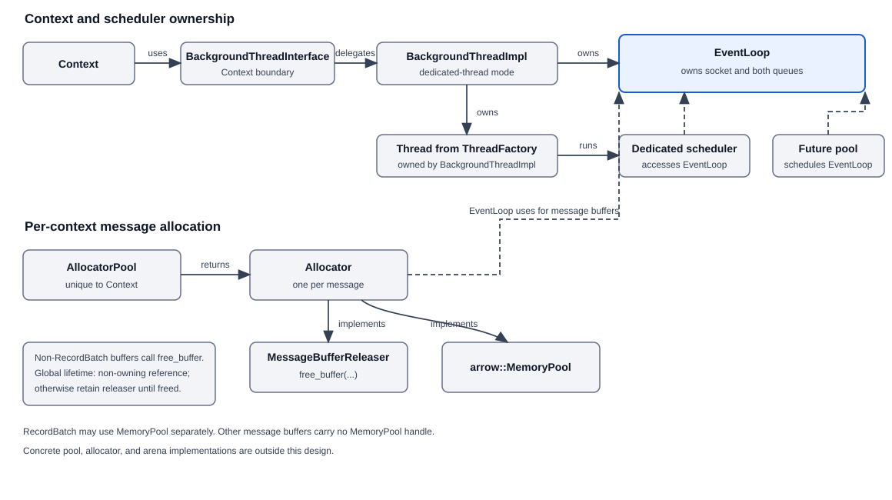
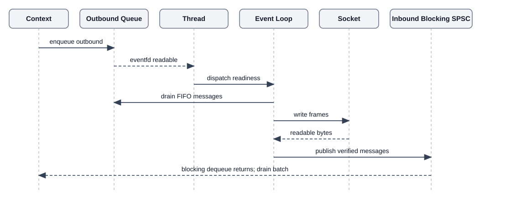

# Background Thread Design

## Purpose and boundary

The `BackgroundThreadInterface` connects a worker-facing `Context` to socket I/O. The production implementation,
`BackgroundThreadImpl`, owns an `EventLoop` and the `Thread` that executes it. `ContextManager` creates the implementation
and starts its thread after the socket, queues, and event-loop state are ready. `ContextImpl` receives only the
interface and does not perform socket I/O.

The event loop contains transport processing and exposes the descriptors and readiness interests needed by a
scheduler. The first scheduler is a dedicated thread with a Linux epoll wait. A future pool scheduler can wait on the
same event-loop descriptors and dispatch readiness without changing framing, queue, or socket processing rules.
Scheduler code owns blocking readiness waits; `EventLoop` owns readiness handling and transport state.

The Context-facing message and close semantics remain defined by
[context_implementation.md](context_implementation.md). Wire framing and protocol rules remain defined by the
[low-level protocol](../protocol/low_level/protocol.md).

## Components and ownership



The [Mermaid source](background_thread_ownership.mmd) is the source of truth for this component diagram.

`EventLoop` owns both queue objects for their full lifetime. It also implements the operations of
`BackgroundThreadInterface`; `ContextImpl` accesses the queues only through that interface and holds no queue
references. The event loop is the outbound consumer and inbound producer, while Context is the opposite endpoint of
each queue. The two queues are the cross-thread boundary. The outbound queue is a
`WaitableQueue<SpscQueue<OutboundMessage>>`;
its eventfd lets the event loop wait for either outbound work or socket readiness. The inbound queue is Moodycamel's
unbounded `BlockingReaderWriterQueue<InboundQueueEntry>`. It has dynamically growing storage and adds blocking and
timed blocking dequeue operations to the non-circular SPSC queue API. The repository's `SpscQueue` alias names the
nonblocking `ReaderWriterQueue`; the inbound queue uses the blocking counterpart from the same upstream library.
See the [Moodycamel queue documentation](https://github.com/cameron314/readerwriterqueue#use).

Each `Context` has its own abstract `AllocatorPool`. `EventLoop` directly uses that pool to allocate inbound message
storage; `BackgroundThreadImpl` only owns and schedules the event loop and does not use the pool itself. For every
message, the event loop obtains one `Allocator` from the context's pool and uses it to allocate all buffers belonging
to that message. A message may contain multiple buffers, all allocated through the same allocator. The allocator
implements two interfaces: `MessageBufferReleaser`, which frees non-RecordBatch message buffers, and Arrow's
`arrow::MemoryPool`.

The interfaces serve different message ownership needs. A non-RecordBatch message buffer uses
`MessageBufferReleaser::free_buffer` to release the allocation. Its release owner does not expose or retain the memory-pool
interface. An Arrow `RecordBatch` may retain or use the allocator through `arrow::MemoryPool` when its Arrow ownership
requires the pool interface. The message representation keeps these references distinct rather than making every
buffer depend on the memory pool.

The pool reports whether its returned allocators have global lifetime. A release owner for a non-RecordBatch buffer
always calls `free_buffer`. For a global-lifetime allocator it keeps only a non-owning `MessageBufferReleaser` reference;
the pool's lifetime guarantee keeps that reference valid, so the message does not own the allocator. For a
non-global allocator it also retains a `std::shared_ptr<MessageBufferReleaser>` until after `free_buffer` returns. Arrow
`RecordBatch` ownership may retain the memory-pool interface as required by Arrow. A pool is not shared between
contexts. An allocator may be implemented with an arena, but this design specifies only the interfaces and lifetime
relationship; it defines no concrete pool, allocator, or arena implementation.

The conceptual C++ contracts are:

```cpp
class MessageBufferReleaser
{
public:
    virtual ~MessageBufferReleaser() = default;
    virtual void free_buffer(std::uint8_t* buffer, std::int64_t size, std::int64_t alignment) = 0;
};

class Allocator : public MessageBufferReleaser, public arrow::MemoryPool
{
public:
    ~Allocator() override = default;
};

class AllocatorPool
{
public:
    virtual ~AllocatorPool() = default;
    [[nodiscard]] virtual std::shared_ptr<Allocator> acquire() = 0;
    [[nodiscard]] virtual bool allocators_have_global_lifetime() const noexcept = 0;
};
```

The sketch shows the release method on `MessageBufferReleaser`; allocation and RecordBatch memory-pool methods remain on
`arrow::MemoryPool`. It omits pool construction and implementation. The event loop records the allocator, buffer
address, size, and alignment in each non-RecordBatch buffer's release action. That action calls `free_buffer` with
those values. For a non-global allocator, its release owner retains a `std::shared_ptr<MessageBufferReleaser>` converted
from the acquired `Allocator` until after the call. For a global allocator, it uses a non-owning
`MessageBufferReleaser` reference because the pool guarantees that the allocator remains alive; the message carries no
allocator ownership. An Arrow `RecordBatch` may retain or use a `std::shared_ptr<arrow::MemoryPool>` separately when
its ownership requires it. Ordinary message-buffer owners do not carry that interface.

The `BlockingReaderWriterQueue` only stores and transfers completed inbound message entries. It does not use the
allocator pool or allocate message buffers.

`EventLoop` owns the connected non-blocking socket, frame decoder, receive buffer, pending partial writes, protocol
connection state, transport deadlines, and both queue instances. It never calls worker code or blocks while publishing
inbound messages. The unbounded inbound queue grows as needed; its consumer blocks only when it is empty.

`BackgroundThreadImpl` owns an `EventLoop` and a `Thread` created by `ThreadFactory`. Its task runs the dedicated
scheduler, which waits on the event loop's descriptors with `LinuxEpoll`, passes readiness events to the loop, and
reconfigures interest as requested by the loop. The wrapper delegates Context-facing operations to its `EventLoop`.
The scheduler accesses the loop directly; it does not reach it through the Context-facing interface.

In a thread-pool configuration, the scheduler holds and schedules the `EventLoop` directly. It does not require a
dedicated-thread wrapper around the loop. The loop's descriptor and readiness contract is the scheduling boundary for
both configurations.

## Event-loop descriptor contract

The event loop exposes a snapshot of descriptors and readiness interests. The initial set includes:

- the connected socket, always watched for readable, error, and hangup events;
- the outbound queue notification fd, watched for readability.

The socket is watched for writable readiness only while encoded bytes remain pending. An always-writable socket would
cause a busy loop. After handling readiness or queue work, the loop returns the updated interests to the scheduler.
The scheduler does not interpret queue notifications as message counts and does not own socket or queue state.

Before the scheduler blocks, the loop drains currently available outbound items and checks the queue again after
updating interests. This closes the enqueue-versus-wait race: if an enqueue happens before the check, the loop sees the
item; if it happens after the check, the waitable queue's eventfd wakes the scheduler. The loop drains notifications,
then drains the queue until empty. `EAGAIN` while draining eventfd means there are no more notification counts to read;
it is not a queue error.

When socket input begins a new message, the event loop obtains a fresh `Allocator` from that Context's `AllocatorPool`
and uses it for every buffer belonging to that message. A message may allocate multiple buffers through the same
allocator; the loop does not reuse that allocator for another message. Once the message has been verified and
published, its buffer-release objects transfer with the message and call `MessageBufferReleaser::free_buffer` when each
non-RecordBatch buffer is released. They retain shared allocator ownership only when the pool reports non-global
allocator lifetime. An Arrow `RecordBatch` may retain or use the allocator's `arrow::MemoryPool` interface separately.
The allocator may own or refer to an arena, according to its implementation.

The loop handles socket readiness using non-blocking operations. It treats `EINTR` as retryable and `EAGAIN` or
`EWOULDBLOCK` as a return to readiness waiting. It reads arbitrary fragments into the decoder, publishes complete
verified messages in order, and retains incomplete bytes. It serializes outbound logical messages into frames and
preserves FIFO order across partial writes. Read and write processing are bounded per cycle so continuous activity in
one direction does not starve the other. Detailed send credit and stream ordering rules are in
[context implementation](context_implementation.md#background-credit-and-split-state).

When socket and outbound readiness arrive together, the loop records terminal socket errors first, processes readable
socket bytes and publishes complete inbound messages, then processes outbound messages and pending writes. It rechecks
terminal state, the outbound queue, and pending writes before sleeping again. A malformed frame and a terminal
transport error latch the first `ErrorInfo`, stop ordinary I/O, and notify inbound waiters.

## Dedicated-thread lifecycle

Construction does not start execution. `BackgroundThreadImpl` creates its `Thread` through `ThreadFactory` with a task
that runs the dedicated scheduler. `ContextManager` starts that thread only after the event loop and queue endpoints are
fully initialized. A thread-start failure is reported to ContextManager, which does not publish a usable context.

The lifecycle is:

```text
Constructed -> Started -> Running -> StopRequested -> Joined
                    \          \-> Failed -> Joined
                     \-> startup failure
```

The first terminal loop failure is latched and published as an internal `BackgroundThreadResult` entry in the inbound
queue. A Context waiting for work wakes through the same blocking SPSC dequeue used for inbound messages. The queue
entry distinguishes a terminal result from a protocol message, so no synthetic protocol view reaches the dispatcher.

The Context owns protocol shutdown policy. It stops accepting new worker messages, queues the required
`CloseConnection` message, and calls `request_shutdown(deadline)` with its absolute steady-clock deadline. The event
loop sends accepted messages in FIFO order, completes the close exchange when possible, and exits when the peer reply
arrives or the deadline expires. On deadline expiry it stops socket work and releases messages still owned by the
transport. `BackgroundThreadImpl` joins its thread before releasing the event loop, socket, or queue endpoints. A
terminal socket or protocol failure skips the close exchange and preserves the first failure.

The deadline is absolute so nested waits do not reset the shutdown budget. The thread remains joinable until its task
has returned; timed-out shutdown waiting never detaches or destroys a running task. This follows the
[ThreadFactory join contract](thread_factory_design.md#join-contract).

## Context-facing interface

The inbound queue carries either a verified message or a background event:

```cpp
using InboundQueueEntry = std::variant<InboundMessage, BackgroundThreadResult>;
using InboundQueue = third_party::moodycamel::BlockingReaderWriterQueue<InboundQueueEntry>;
```

`wait_until()` waits on this queue, using a timed blocking dequeue when the caller supplies a deadline. If it removes an
inbound message, it stages that message inside `BackgroundThreadImpl` and returns `InboundAvailable`; the next
`dequeue_inbound_messages()` includes the staged message before draining the remaining available entries. A terminal
entry is latched and returned as `ShutdownRequested`. `dequeue_inbound_messages()` also recognizes and latches a
terminal entry if it encounters one while draining, and never exposes that entry as a protocol message. This preserves
the existing wait-then-drain interface without an inbound notification fd. The non-circular queue grows as needed;
only its consumer blocks when it is empty.

The conceptual interface is:

```cpp
class BackgroundThreadInterface {
public:
    virtual BackgroundThreadResult wait_until(
        std::optional<std::chrono::steady_clock::time_point> deadline) = 0;
    virtual bool enqueue_outbound_messages(OutboundBatch& messages) = 0;
    virtual bool enqueue_outbound_message(OutboundMessage& message) = 0;
    virtual InboundBatch dequeue_inbound_messages() = 0;
    virtual void request_shutdown(
        std::chrono::steady_clock::time_point deadline) noexcept = 0;
};

class BackgroundThreadImpl final : public BackgroundThreadInterface {
    std::unique_ptr<EventLoop> event_loop;
    std::unique_ptr<Thread> thread;
};
```

`EventLoop` implements the same interface in the conceptual design and owns the queues. In the initial dedicated-thread
configuration, `BackgroundThreadImpl` implements the interface by delegating to its loop. In a pool configuration,
Context can use the loop directly while the scheduler holds the same loop for readiness dispatch. The sketch omits
construction dependencies and the scheduler's epoll registrations. Enqueue operations are non-blocking; success
transfers ownership to the outbound queue and failure leaves the caller's messages unchanged. Dequeue transfers all
currently available verified messages to Context. `wait_until()` reports inbound availability, shutdown, deadline
expiry, or the latched terminal error. The shutdown deadline parameter makes the Context-owned bounded policy explicit.

The concrete `BackgroundThreadImpl` owns thread startup and join. `ContextManager` is responsible for calling its
startup operation after setup; `ContextImpl` requests shutdown through the interface and never sees the thread or its
native handle. Tests inject a `BackgroundThreadInterface` mock at the Context boundary and can separately test
`EventLoop` readiness handling without starting a native thread.

## Interaction



The [Mermaid source](background_thread_interaction.mmd) is the source of truth for this interaction diagram.
