# v2 Interface and Internal Class Diagram

This document describes the current worker-facing v2 interfaces and the internal classes that build, retain, and
transfer their messages.

Diagram source: [interface_class_diagram.mmd](interface_class_diagram.mmd). Rendered diagram:
[interface_class_diagram.svg](interface_class_diagram.svg).

## Current design

- `Context`, `Call`, `ControlStream`, the message builders, and the message views are abstract interfaces in
  `exasol::udf::v2::interface`.
- `Context` creates an opening-call builder. `Call` and `ControlStream` create builders bound to their own stream IDs.
- The concrete message builders retain internal `CallMessage` or `ControlMessage` state and expose it to the encoder.
  These message state classes are internal and are not part of the worker-facing API.
- Concrete message views keep a shared `DecodedFrame` alive while they expose optional references to generated
  FlatBuffer tables.
- `DataSchemaView` and `RecordBatchView` are abstract ownership interfaces with internal implementations. The
  current `CallMessageViewImpl` does not yet construct them from received Arrow data, so its corresponding accessors
  return `nullptr`.
- `BackgroundThreadInterface` is an internal abstract boundary for the low-level context. Production code owns queue
  endpoints and the background thread behind it; tests can inject a mock through the same boundary.
- No concrete transport or worker-facing `Context` implementation is defined by these declarations.

## Class diagram

```mermaid
classDiagram
direction TB

namespace exasol_udf_v2_interface {
    class Context {
        <<abstract>>
        +receive_status() MessageStatus
        +is_new_inbound_call_available() bool
        +wait_for_message() MessageStatus
        +wait_for_message(Timeout) MessageStatus
        +accept_call() Result~unique_ptr~Call~~
        +create_opening_call_message_builder() unique_ptr~OpeningCallMessageBuilder~
        +open_call(unique_ptr~OpeningCallMessageBuilder~) Result~unique_ptr~Call~~
        +control_stream() ControlStream&
    }
    class Call {
        <<abstract>>
        +receive_status() MessageStatus
        +create_message_builder() unique_ptr~CallMessageBuilder~
        +receive() Result~unique_ptr~CallMessageView~~
        +receive(Timeout) Result~unique_ptr~CallMessageView~~
        +send(unique_ptr~CallMessageBuilder~) Result~void~
        +send(unique_ptr~CallMessageBuilder~, Timeout) Result~void~
    }
    class ControlStream {
        <<abstract>>
        +receive_status() MessageStatus
        +create_message_builder() unique_ptr~ControlMessageBuilder~
        +receive() Result~unique_ptr~ControlMessageView~~
        +receive(Timeout) Result~unique_ptr~ControlMessageView~~
        +send(unique_ptr~ControlMessageBuilder~) Result~void~
    }
    class CallMessageBuilderBase {
        <<abstract>>
        +add_payload(name, value, binary) CallMessageBuilderBase&
        +data_schema(schema, has_group_id, has_row_id) CallMessageBuilderBase&
        +reset(row_id) CallMessageBuilderBase&
        +record_batch(array, is_end_of_group) CallMessageBuilderBase&
        +error(code, message) CallMessageBuilderBase&
        +close_call() CallMessageBuilderBase&
    }
    class CallMessageBuilder {
        <<abstract>>
    }
    class OpeningCallMessageBuilder {
        <<abstract>>
        +open_call(name) OpeningCallMessageBuilder&
    }
    class ControlMessageBuilder {
        <<abstract>>
        +server_capabilities(major, minor, endianness, workers) ControlMessageBuilder&
        +keep_alive() ControlMessageBuilder&
        +add_payload(name, value, binary) ControlMessageBuilder&
        +error(code, message) ControlMessageBuilder&
        +close_connection() ControlMessageBuilder&
    }
    class CallMessageView {
        <<abstract>>
        +stream_id() uint64_t
        +open_call() optional~ref~protocol::OpenCall~~
        +payloads() optional~ref~protocol::Payloads~~
        +data_schema() unique_ptr~DataSchemaView~
        +reset() optional~ref~protocol::Reset~~
        +record_batch() unique_ptr~RecordBatchView~
        +error() optional~ref~protocol::Error~~
        +close_call() optional~ref~protocol::CloseCall~~
    }
    class ControlMessageView {
        <<abstract>>
        +stream_id() uint64_t
        +server_capabilities() optional~ref~protocol::ServerCapabilities~~
        +keep_alive() optional~ref~protocol::KeepAlive~~
        +payloads() optional~ref~protocol::Payloads~~
        +error() optional~ref~protocol::Error~~
        +close_connection() optional~ref~protocol::CloseConnection~~
    }
    class DataSchemaView {
        <<abstract>>
        +take_schema() && ArrowSchemaPtr
        +has_group_id() bool
        +has_row_id() bool
    }
    class RecordBatchView {
        <<abstract>>
        +take_array() && ArrowArrayPtr
        +is_end_of_group() bool
    }
    class ErrorInfo
}

namespace exasol_udf_v2_internal {
    class CallMessageBuilderImpl {
        -CallMessage message_
        +message() CallMessage&
    }
    class OpeningCallMessageBuilderImpl {
        -CallMessage message_
        +message() CallMessage&
    }
    class ControlMessageBuilderImpl {
        -ControlMessage message_
        +message() ControlMessage&
    }
    class CallMessage {
        -uint64 stream_id_
        -optional open_call_
        -vector payloads_
        -optional data_schema_
        -optional reset_row_id_
        -optional record_batch_
        -optional error_
        -bool close_call_
    }
    class ControlMessage {
        -uint64 stream_id_
        -optional server_capabilities_
        -bool keep_alive_
        -vector payloads_
        -optional error_
        -bool close_connection_
    }
    class DataSchema {
        -ArrowSchemaPtr schema_
        -bool has_group_id_
        -bool has_row_id_
    }
    class RecordBatch {
        -ArrowArrayPtr array_
        -bool is_end_of_group_
    }
    class ServerCapabilities
    class Payload
    class CallMessageViewImpl {
        -shared_ptr~DecodedFrame~ decoded_frame_
    }
    class ControlMessageViewImpl {
        -shared_ptr~DecodedFrame~ decoded_frame_
    }
    class DataSchemaViewImpl {
        -ArrowSchemaPtr schema_
        -bool has_group_id_
        -bool has_row_id_
    }
    class RecordBatchViewImpl {
        -ArrowArrayPtr array_
        -bool is_end_of_group_
    }
    class BackgroundThreadInterface {
        <<abstract>>
        +wait_until(optional~time_point~) BackgroundThreadResult
        +enqueue_outbound_message(OutboundMessage&&) bool
        +enqueue_outbound_messages(OutboundBatch&&) bool
        +dequeue_inbound_messages() InboundBatch
        +request_shutdown() void
    }
    class Event {
        <<enumeration>>
        InboundAvailable
        ShutdownRequested
        DeadlineExpired
    }
    class BackgroundThreadResult {
        +Event event
        +optional~ErrorInfo~ error
    }
    class OutboundMessage
    class InboundMessage
    class OutboundBatch
    class InboundBatch
    class MessageBuilderFactory
}

namespace exasol_udf_protocol {
    class DecodedFrame {
        -shared_ptr~vector~uint8_t~~ buffer_
        +decode(buffer) optional~DecodedFrame~
        +frame() protocol::Frame&
    }
    class Frame {
        <<generated FlatBuffer type>>
    }
    class Reset {
        <<generated FlatBuffer type>>
    }
    class OpenCall {
        <<generated FlatBuffer type>>
    }
    class Payloads {
        <<generated FlatBuffer type>>
    }
    class Error {
        <<generated FlatBuffer type>>
    }
    class CloseCall {
        <<generated FlatBuffer type>>
    }
    class ServerCapabilities {
        <<generated FlatBuffer type>>
    }
    class KeepAlive {
        <<generated FlatBuffer type>>
    }
    class CloseConnection {
        <<generated FlatBuffer type>>
    }
}

Context --> Call : accepts or opens
Context --> ControlStream : returns stream zero
Context ..> OpeningCallMessageBuilder : creates
Call --> CallMessageBuilder : creates and sends
ControlStream --> ControlMessageBuilder : creates and sends

CallMessageBuilder --|> CallMessageBuilderBase
OpeningCallMessageBuilder --|> CallMessageBuilderBase
CallMessageBuilderImpl --|> CallMessageBuilder
OpeningCallMessageBuilderImpl --|> OpeningCallMessageBuilder
ControlMessageBuilderImpl --|> ControlMessageBuilder
Call --> CallMessageView : receives
ControlStream --> ControlMessageView : receives
CallMessageViewImpl --|> CallMessageView
ControlMessageViewImpl --|> ControlMessageView
DataSchemaViewImpl --|> DataSchemaView
RecordBatchViewImpl --|> RecordBatchView

CallMessageBuilderImpl *-- CallMessage : owns
OpeningCallMessageBuilderImpl *-- CallMessage : owns
ControlMessageBuilderImpl *-- ControlMessage : owns
CallMessage *-- DataSchema : optional
CallMessage *-- RecordBatch : optional
CallMessage *-- Payload : contains
ControlMessage *-- ServerCapabilities : optional
ControlMessage *-- Payload : contains
DataSchemaViewImpl o-- ArrowSchemaPtr : owns
RecordBatchViewImpl o-- ArrowArrayPtr : owns

CallMessageViewImpl o-- DecodedFrame : shared frame lifetime
ControlMessageViewImpl o-- DecodedFrame : shared frame lifetime
CallMessageViewImpl ..> Reset : returns wire view
CallMessageViewImpl ..> OpenCall : returns wire view
CallMessageViewImpl ..> Payloads : returns wire view
CallMessageViewImpl ..> Error : returns wire view
CallMessageViewImpl ..> CloseCall : returns wire view
ControlMessageViewImpl ..> ServerCapabilities : returns wire view
ControlMessageViewImpl ..> KeepAlive : returns wire view
ControlMessageViewImpl ..> Payloads : returns wire view
ControlMessageViewImpl ..> Error : returns wire view
ControlMessageViewImpl ..> CloseConnection : returns wire view
DecodedFrame --> Frame : exposes verified view
DecodedFrame *-- "owned bytes" Frame : backs generated objects

BackgroundThreadInterface ..> OutboundMessage : accepts
BackgroundThreadInterface ..> OutboundBatch : accepts
BackgroundThreadInterface ..> InboundBatch : returns
BackgroundThreadResult --> Event : reports
OutboundMessage ..> CallMessageBuilderBase : holds unique_ptr
OutboundMessage ..> ControlMessageBuilder : holds unique_ptr
InboundMessage ..> CallMessageView : holds unique_ptr
InboundMessage ..> ControlMessageView : holds unique_ptr
MessageBuilderFactory ..> CallMessageBuilderImpl : creates
MessageBuilderFactory ..> OpeningCallMessageBuilderImpl : creates
MessageBuilderFactory ..> ControlMessageBuilderImpl : creates

note for BackgroundThreadInterface "Internal low-level Context boundary. Production owns queues and the thread; tests inject a mock."
note for InboundMessage "The low-level context reads stream identity from the view to demultiplex the shared inbound queue."
note for CallMessageViewImpl "Arrow DataSchemaView and RecordBatchView are currently null until transport import is implemented."
```

Legend:

- `*--` indicates owned composition.
- `o--` indicates shared or indirect lifetime association.
- `-->` indicates an API or implementation dependency.
- `..>` indicates a non-owning/reference dependency.
- `--|>` indicates inheritance or interface implementation.

The `take_schema()` and `take_array()` relationships transfer ownership; they do not expose borrowed raw pointers.
