# v2 Interface PR Analysis and Class Diagram

This document analyzes the `origin/main...feature/interface` changes and shows
the dependencies introduced by the v2 public interface layer.

Diagram source: [interface_class_diagram.mmd](interface_class_diagram.mmd). Rendered diagram:
[interface_class_diagram.svg](interface_class_diagram.svg).

## PR analysis

The PR changes 30 files and adds the following areas:

- Abstract APIs: `Context`, `Call`, and `ControlStream`.
- Message and result types: `CallMessage`, `ControlMessage`, `Result<T>`, and
  `ErrorInfo`.
- Builders for outbound call and control messages.
- Views for inbound call and control messages.
- `DecodedFrame` with verified, owned FlatBuffer storage.
- Arrow C Data Interface ownership through custom smart-pointer deleters.
- Bazel integration and interface/protocol tests.

Important design observations:

- `Context` is the connection-level entry point.
- `Call` represents a non-zero protocol stream.
- `ControlStream` represents stream zero.
- Builders own high-level message objects.
- Views retain a shared `DecodedFrame` so generated FlatBuffer references remain
  valid.
- Views expose both copied high-level values and direct wire-level FlatBuffer
  objects, while Arrow data is transferred through explicit move operations.
- A separate public `import_record_batch` utility converts moved Arrow C Data
  objects into `arrow::RecordBatch`; it is not part of the context interface.
- The PR defines interface and decoding infrastructure, but no concrete
  transport implementation; `Context`, `Call`, and `ControlStream` remain
  abstract.
- Data-schema and record-batch model types exist, but the current frame decoder
  does not populate them. The protocol tests explicitly expect data-only frames
  to produce empty views.

## Class diagram

```mermaid
classDiagram
direction TB

namespace exasol_udf_v2 {
    class Context {
        <<abstract>>
        +receive_status() MessageStatus
        +wait_for_message(timeout) MessageStatus
        +accept_call() Result~unique_ptr~Call~~
        +open_call(builder) Result~unique_ptr~Call~~
        +control_stream() ControlStream&
    }

    class Call {
        <<abstract>>
        +receive_status() MessageStatus
        +receive(timeout) Result~CallMessageView~
        +send(builder, timeout) Result~void~
    }

    class ControlStream {
        <<abstract>>
        +receive_status() MessageStatus
        +receive(timeout) Result~ControlMessageView~
        +send(builder) Result~void~
    }

    class CallMessageBuilder {
        -CallMessage message_
        +open_call(name) CallMessageBuilder&
        +add_payload(name, value, binary) CallMessageBuilder&
        +data_schema(schema, flags) CallMessageBuilder&
        +next(byte_budget, reset, row_id) CallMessageBuilder&
        +record_batch(array, end_of_group) CallMessageBuilder&
        +error(code, text) CallMessageBuilder&
        +close_call() CallMessageBuilder&
        +message() CallMessage&
        +take() CallMessage
    }

    class ControlMessageBuilder {
        -ControlMessage message_
        +server_capabilities(...) ControlMessageBuilder&
        +keep_alive() ControlMessageBuilder&
        +add_payload(name, value, binary) ControlMessageBuilder&
        +error(code, text) ControlMessageBuilder&
        +close_connection() ControlMessageBuilder&
        +message() ControlMessage&
        +take() ControlMessage
    }

    class CallMessageView {
        -optional~CallMessage~ call_message_
        -shared_ptr~DecodedFrame~ decoded_frame_
        +open_call() OpenCall&
        +payloads() protocol::Payloads&
        +data_schema() DataSchemaView
        +next() Next&
        +record_batch() RecordBatchView
        +error() ErrorInfo&
    }

    class ControlMessageView {
        -optional~ControlMessage~ control_message_
        -shared_ptr~DecodedFrame~ decoded_frame_
        +server_capabilities() protocol::ServerCapabilities&
        +payloads() protocol::Payloads&
        +error() ErrorInfo&
    }

    class DataSchemaView {
        -reference DataSchema
        +take_schema() ArrowSchemaPtr
        +has_group_id() bool
        +has_row_id() bool
    }

    class RecordBatchView {
        -reference RecordBatch
        +take_array() ArrowArrayPtr
        +is_end_of_group() bool
    }

    class CallMessage {
        +optional~OpenCall~ open_call
        +optional~Payloads~ payloads
        +optional~DataSchema~ data_schema
        +optional~Next~ next
        +optional~OutboundNext~ outbound_next
        +optional~RecordBatch~ record_batch
        +optional~ErrorInfo~ error
        +bool close_call
    }

    class ControlMessage {
        +optional~ServerCapabilities~ server_capabilities
        +optional~Payloads~ payloads
        +optional~ErrorInfo~ error
        +bool keep_alive
        +bool close_connection
    }

    class Payload
    class Payloads
    class OpenCall
    class Next
    class OutboundNext
    class ServerCapabilities
    class DataSchema
    class RecordBatch
    class ErrorInfo
}

namespace exasol_udf_protocol {
    class DecodedFrame {
        -shared_ptr~vector~uint8_t~~ buffer_
        +decode(buffer) optional~DecodedFrame~
        +frame() protocol::Frame&
    }

    class Frame {
        <<generated FlatBuffer type>>
    }

    class WirePayloads {
        <<generated FlatBuffer type>>
    }

    class WireServerCapabilities {
        <<generated FlatBuffer type>>
    }
}

Context --> Call : accepts/opens
Context --> ControlStream : returns stream zero
Context --> CallMessageBuilder : opens outbound call

Call --> CallMessageBuilder : sends
Call --> CallMessageView : receives

ControlStream --> ControlMessageBuilder : sends
ControlStream --> ControlMessageView : receives

CallMessageBuilder *-- CallMessage : owns
ControlMessageBuilder *-- ControlMessage : owns

CallMessage *-- OpenCall : optional
CallMessage *-- Payloads : optional
CallMessage *-- DataSchema : optional
CallMessage *-- Next : optional
CallMessage *-- OutboundNext : optional
CallMessage *-- RecordBatch : optional
CallMessage *-- ErrorInfo : optional

ControlMessage *-- ServerCapabilities : optional
ControlMessage *-- Payloads : optional
ControlMessage *-- ErrorInfo : optional

Payloads *-- Payload : contains
CallMessageView *-- CallMessage : decoded snapshot
ControlMessageView *-- ControlMessage : decoded snapshot

CallMessageView o-- DecodedFrame : shared lifetime
ControlMessageView o-- DecodedFrame : shared lifetime
CallMessageView --> DataSchemaView
CallMessageView --> RecordBatchView
DataSchemaView ..> DataSchema : moves schema ownership
RecordBatchView ..> RecordBatch : moves array ownership

CallMessageView --> WirePayloads : direct wire view
ControlMessageView --> WirePayloads : direct wire view
ControlMessageView --> WireServerCapabilities : direct wire view

DecodedFrame --> Frame : exposes generated view
DecodedFrame *-- "owned bytes" Frame : backs generated objects

note for RecordBatchView "Public free function: import_record_batch(ArrowArrayPtr, ArrowSchemaPtr) returns arrow::Result<shared_ptr<arrow::RecordBatch>>"
```

Legend:

- `*--` indicates owned composition.
- `o--` indicates shared or indirect lifetime association.
- `-->` indicates an API or implementation dependency.
- `..>` indicates a non-owning/reference dependency.

The `take_schema()` and `take_array()` relationships are ownership transfers,
not borrowed raw-pointer access. The import utility is public but separate from
the worker-facing context API.

## Validation

- `git diff --check origin/main...HEAD` passed.
- Bazel tests could not be run because `bazel` is not installed on the host.

