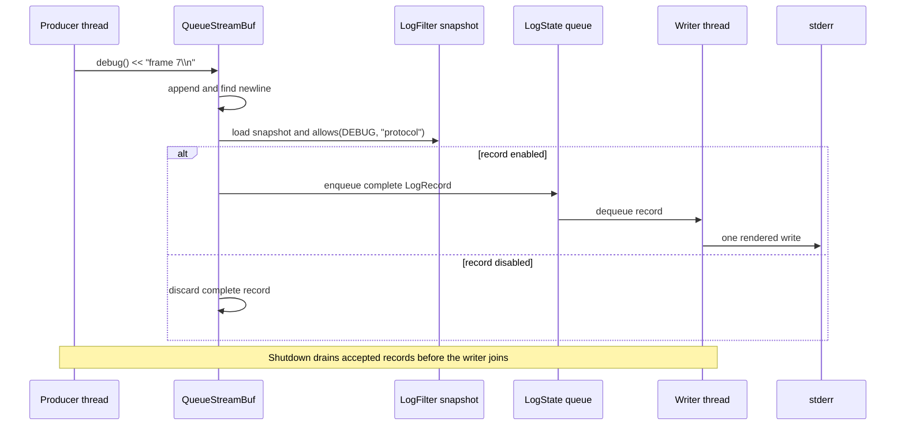

# Asynchronous Logging Provider Design

## Purpose

This document defines the v2 `LoggingProvider` introduced by ticket #142. It
replaces the direct `std::cerr` logging stub with a provider that accepts
concurrent stream-style producer calls, preserves complete records, filters
records before they reach output, and writes accepted records asynchronously.

The design preserves the `LoggingProviderIf` severity accessors. Callers
continue to write through `std::ostream&` references, for example:

```cpp
provider.debug() << "received frame " << frame_id << '\n';
```

The provider is a runner implementation facility. It does not change protocol
v2 wire rules or the worker-facing `LoggingProviderIf` interface.

## Scope and compatibility

`error()`, `warning()`, `notice()`, `debug()`, and `verbose()` retain their
signatures and severity meanings. `UDF_LOG_LEVEL` keeps its existing parsing:
only the single-character values `1` through `4` are valid; an unset or invalid
value selects level `1`.

`verbose()` remains disabled in release builds regardless of `UDF_LOG_LEVEL`.
The lazy helpers in `utils/log_utils.h` continue to use the existing
`is*Enabled()` checks, so disabled lazy messages do not construct their text.

The concrete provider receives a group at construction. Its group is immutable
and is attached to every record emitted by that provider. A component that
needs a distinct group owns a distinct provider, for example
`LoggingProvider{"protocol"}`. The group is not a stream manipulator and is
not part of `LoggingProviderIf`.

## Components and ownership


One `LoggingProvider` creates one shared `LogState` and one writer thread.
`LogState` is the shared home for the provider's group, filter, and unbounded
`BlockingMpmcQueue<LogItem>`.

Each producer thread has its own stream and buffer. When a thread first calls,
for example, `provider.debug()`, `thread_local_stream(state, severity)` creates
that pair and retains it in a cache local to that thread. A later `debug()` call
on the same thread returns the same stream. Another thread gets a separate
stream and buffer, so the two threads never write into the same pending text.

The provider, writer thread, and every live stream buffer share ownership of
`LogState`. Thus the group, filter, and queue stay alive for as long as a live
buffer needs them. The cache identifies a provider by shared ownership rather
than only its memory address, preventing a later provider from accidentally
reusing an old cache entry.

The producer buffer places either a complete `LogRecord` or, during shutdown,
a stop item in the queue. Each record contains its severity, group, and text.
The writer thread is the queue's only consumer and writes one complete rendered
record to `std::cerr` at a time.

```cpp
enum class Severity { kError, kWarning, kNotice, kDebug, kVerbose };

struct LogRecord {
    Severity severity;
    std::string group;
    std::string text;
};

struct LogState {
    std::string group;
    std::atomic<std::shared_ptr<const LogFilter>> filter;
    BlockingMpmcQueue<LogItem> queue;
    std::thread writer;
};

class LoggingProvider final : public LoggingProviderIf {
public:
    explicit LoggingProvider(std::string group, LogFilter filter = default_filter());
    ~LoggingProvider() override;

    std::ostream& error() override;
    std::ostream& warning() override;
    std::ostream& notice() override;
    std::ostream& debug() override;
    std::ostream& verbose() override;

private:
    std::shared_ptr<LogState> state_;
};
```

The sketch omits only internal variant and cache types; it shows the ownership
contract. `LoggingProvider` remains non-copyable and non-movable through its
existing interface base.

## Record construction

Each `QueueStreamBuf` holds the `LogState`, one severity, and a pending text
buffer. It receives stream output as follows:

- `xsputn()` scans every character of a bulk write and commits immediately
  after each newline.
- `overflow()` accepts one character and applies the same newline rule.
- `sync()` commits pending text, implementing `flush()` and `std::endl`.
- A newline is a delimiter, not part of the stored `LogRecord::text`.

For example, writing `"first\\nsecond\\n"` emits two records, `first` and
`second`. Writing `"first"` emits nothing yet; a later newline or flush emits
that pending text. Destruction of a thread-local cache entry commits any
pending text so that a thread does not silently abandon it during normal
thread-local cleanup. An empty pending buffer does not create a record.

Record boundaries reset only the pending text for that stream. They do not
reset or alter the provider group: every record from `LoggingProvider{"protocol"}`
has group `protocol`.

```cpp
void QueueStreamBuf::commit_record()
{
    if (pending_.empty()) return;

    const auto filter = state_->filter.load();
    if (filter->allows(severity_, state_->group)) {
        state_->queue.enqueue(LogRecord{severity_, state_->group, std::move(pending_)});
    }
    pending_.clear();
}
```

The pseudocode illustrates the ordering only. Production code handles
allocation failure as an exceptional failure; it never classifies such a
failure as an intentional dropped log record.

## Filters

`LogFilter` is immutable after publication. It contains a severity mask and an
enabled-group set. Producers atomically load its shared immutable snapshot at
record commit time, so they do not acquire a mutex shared with other producers
or the writer.

`allows(severity, group)` first requires an enabled severity and then applies
the group rule:

- An empty enabled-group set permits every group, including the empty
  (ungrouped) group.
- A non-empty enabled-group set permits only exact members; it therefore
  excludes the empty group unless the empty string is explicitly present.

The provider evaluates this predicate before queue insertion. Disabled records
consume neither queue capacity/memory nor writer time. Filter updates create
and atomically publish a fresh snapshot; they can allocate because updates are
infrequent. A committed record uses the snapshot it loaded, so it may reflect
either side of a concurrent update but never a partially modified filter.

## Rendering and writer lifecycle

The writer renders levels using uppercase labels: `ERROR`, `WARNING`,
`NOTICE`, `DEBUG`, and `VERBOSE`. A grouped debug record has the form
`[DEBUG][protocol] message`; the existing source and thread information follows
the tags according to the logging utility's formatting rules. An empty group is
rendered as an ungrouped record rather than as a fabricated group.

The writer blocks waiting for queue items. It writes accepted `LogRecord`
items in queue order and exits only after consuming a stop item. Provider
destruction has a caller-side precondition: clients have stopped using the
provider and its returned streams. It then enqueues the stop item and joins the
writer. FIFO queue ordering places the stop item behind every record already
accepted by that provider, so destruction drains accepted records before it
returns. It may wait for output I/O; producer logging calls do not.

Thread-local streams can keep `LogState` alive after provider destruction, but
they are not valid for further caller use once the provider begins shutdown.
The precondition prevents late commits from being placed behind the stop item.



## Failure handling and limits

The queue is unbounded: this design intentionally does not drop accepted
records because a capacity was reached. It can therefore consume memory faster
than the writer drains it under sustained overload. Memory allocation failure
is exceptional and is surfaced by the stream/queue operation rather than
silently converted into a normal log drop.

The design does not define recovery from a terminal `stderr` write failure.
The writer does not return failures to producers because it runs asynchronously;
the process's standard stream error state remains the observable output
failure mechanism. This ticket does not add a logging-reconfiguration API or a
bounded/backpressure policy.

## Verification contract

Tests cover the following observable behavior:

- concurrent producer threads generate complete, non-interleaved records with
  their original level and group;
- bulk writes, multiple newlines, `flush()`, and `std::endl` establish the
  specified boundaries, while unterminated text remains pending until a commit
  or thread-local cleanup;
- group and severity filtering occurs before enqueue, including the empty and
  non-empty group-allowlist cases;
- `UDF_LOG_LEVEL` parsing, lazy logging, and release-build verbose suppression
  retain their existing behavior;
- destruction drains every accepted record and joins the writer; and
- producer calls do not wait for writer output I/O.
