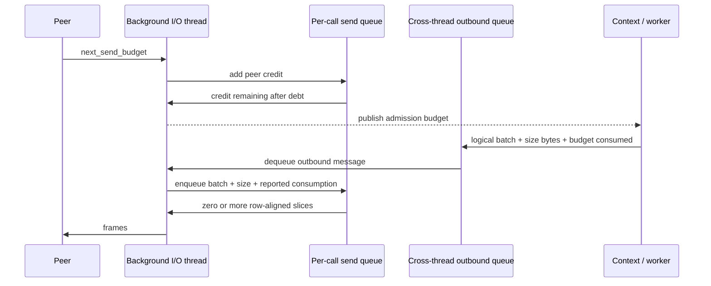
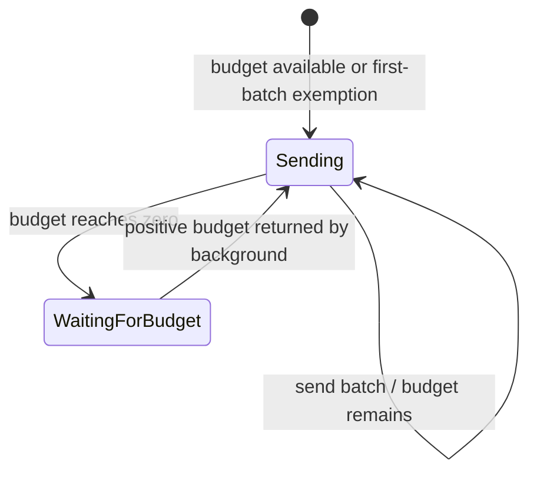
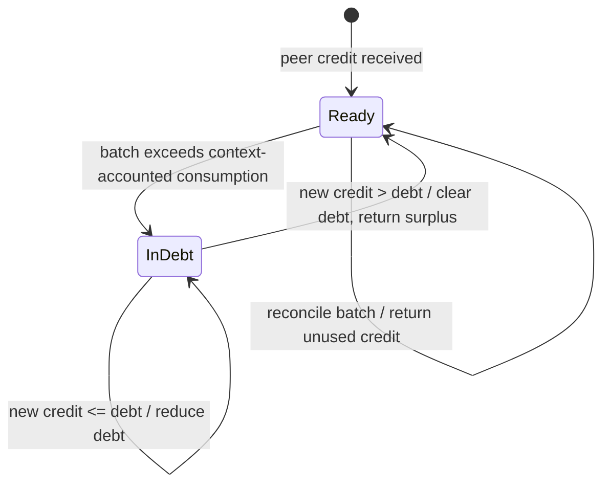

# Send Budget Reconciliation

## Purpose and queue boundaries

This design describes how context-side batch admission and background-side peer credit accounting fit together. There are two distinct queues involved:

1. The **cross-thread outbound queue** carries logical messages, including an unsplit record batch, its serialized size in bytes, and the amount of context budget consumed, from the worker/context thread to the background I/O thread. It preserves FIFO order and transfers ownership. It does not own peer credit, debt, or slicing.
2. The **background per-call send queue** owns peer-granted credit, pending batches, debt reconciliation, and row-aligned slicing into wire frames. It is accessed by the background event-loop thread.

**Budget and batch flow across the queues:**

## Accounting model

The context measures the logical batch size in bytes and consumes that size from its accumulated admission budget. If the batch is larger than the budget, it consumes the remaining budget and sets its budget to zero. It sends both the measured batch size and the amount consumed with the batch through the cross-thread outbound queue. The background send queue uses this metadata to calculate any excess batch bytes as debt; it does not size the batch again. New peer credit pays debt first, and the send queue returns only the surplus to the context. The context accumulates returned budget for later sends.

Let `A` be the context's budget immediately before sending, `C` the amount it reports consumed, and `B` the serialized batch size in bytes that it reports. The context reports `C = min(A, B)` and retains `A - C` as its budget.

The send queue records `max(0, B - C)` as batch-level debt. Any budget returned by the send queue is accumulated by the context for later sends.

Slicing uses the send queue's reconciled credit and row sizes. If an indivisible row crosses the available credit while selecting a slice, the queue includes that row and clamps available credit to zero; this row-boundary overshoot is discarded and does not add to batch-level debt.

The first logical batch in a direction retains the protocol's existing no-credit exception and does not create debt. Empty batches consume no byte credit.

## Worked example

Assume the context has 100 bytes of budget and sends a 130-byte batch. It consumes the 100 bytes available and reports 100 consumed, leaving its budget at zero. The send queue records 30 bytes of debt. Later peer credit of 70 bytes pays that debt first, leaving 40 bytes for the context.

| Event | Allowance / peer credit | Batch bytes | Reported consumed | Debt after event | Credit returned to context |
|---|---:|---:|---:|---:|---:|
| Context submits batch | 100 | 130 | 100 consumed | 30 | 0 |
| Peer grants more credit | 70 | — | — | 0 | 40 |

This example's 30-byte debt comes from the complete logical batch exceeding the context's consumed budget. A separate row-boundary overshoot during slicing would be clamped to zero and discarded; it would not increase the debt shown here.

**Context budget state machine:**

The context accumulates each budget grant returned by the background send queue. Sending a batch consumes `min(batch size, available context budget)`; a batch larger than the available budget consumes the remainder and causes the send queue to account for the excess as debt.

## Send queue budget state machine

