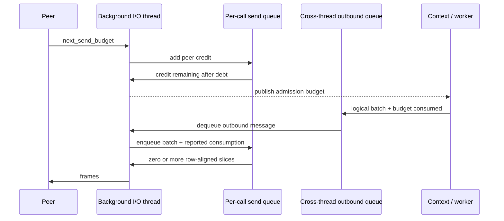
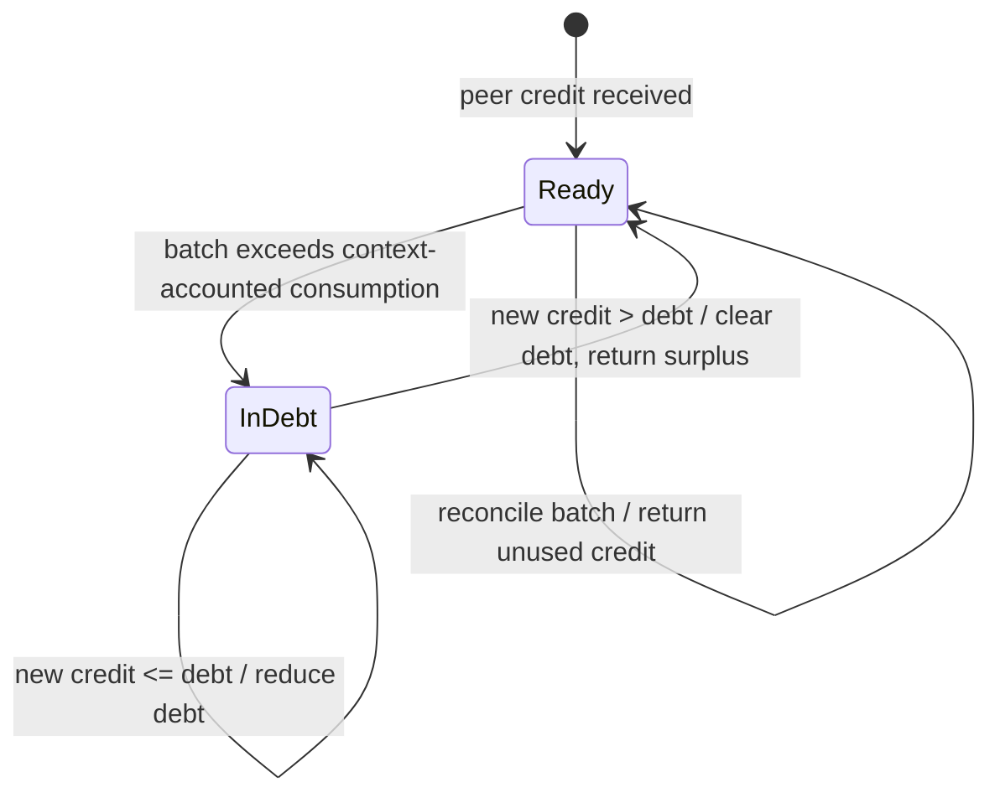

# Send Budget Reconciliation

## Purpose and queue boundaries

This design describes how context-side batch admission and background-side peer credit accounting fit together. There are two distinct queues involved:

1. The **cross-thread outbound queue** carries logical messages, including an unsplit record batch and the context's remaining admission budget, from the worker/context thread to the background I/O thread. It preserves FIFO order and transfers ownership. It does not own peer credit, debt, or slicing.
2. The **background per-call send queue** owns peer-granted credit, pending batches, debt reconciliation, and row-aligned slicing into wire frames. It is accessed by the background event-loop thread.

## Accounting model

The context measures the logical batch and consumes its size from its admission budget. If the batch is larger than the remaining budget, the context consumes the remainder and sets its budget to zero. It sends the amount consumed together with the batch through the cross-thread outbound queue. The background send queue compares that reported consumption with the serialized Arrow buffer bytes for the batch. Any excess batch bytes become debt owned by the send queue. New peer credit pays debt first; only the surplus is published as the next context admission allowance. The cross-thread queue merely transports the batch and its reported consumption.

Let `A` be the context's budget immediately before sending, `C` the amount it reports consumed, and `B` the actual serialized buffer bytes in the batch. The context reports `C = min(A, B)` and retains `A - C` as its budget. The send queue records `max(0, B - C)` as new debt. Any remaining budget and any credit returned after debt reconciliation are combined only on the context side. Slicing uses the send queue's reconciled credit and row sizes. An indivisible row may overshoot available credit; that overshoot is recorded as debt rather than discarded.

The first logical batch in a direction retains the protocol's existing no-credit exception and does not create debt. Empty batches consume no byte credit.

## Worked example

Assume the context has 100 bytes of budget and sends a 130-byte batch. It consumes the 100 bytes available and reports 100 consumed, leaving its budget at zero. The send queue records 30 bytes of debt. Later peer credit of 70 bytes pays that debt first, leaving 40 bytes for the context.

| Event | Allowance / peer credit | Batch bytes | Reported consumed | Debt after event | Credit returned to context |
|---|---:|---:|---:|---:|---:|
| Context submits batch | 100 | 130 | 100 consumed | 30 | 0 |
| Peer grants more credit | 70 | — | — | 0 | 40 |

## Budget state

