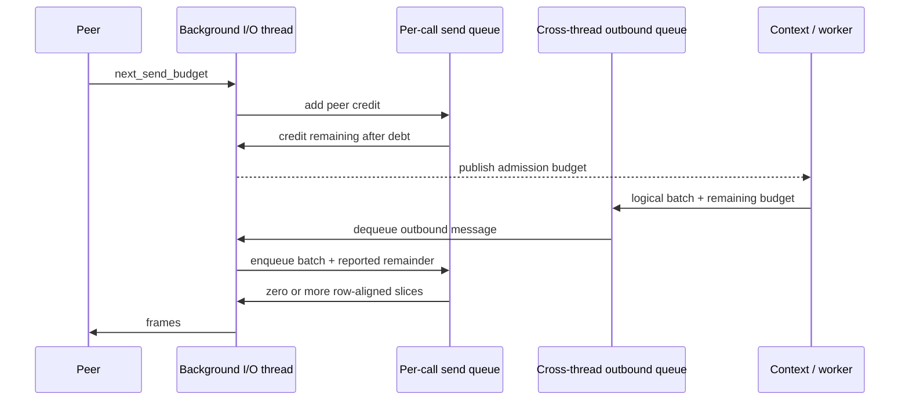
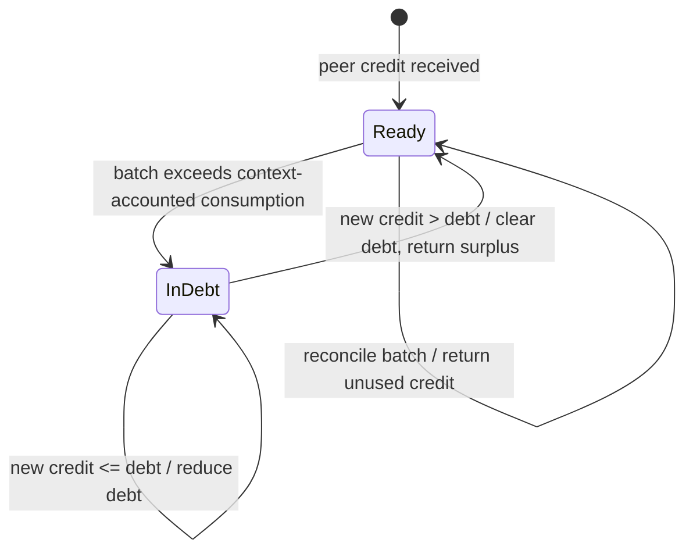

# Send Budget Reconciliation

## Purpose and queue boundaries

This design describes how context-side batch admission and background-side peer credit accounting fit together. There are two distinct queues involved:

1. The **cross-thread outbound queue** carries logical messages, including an unsplit record batch and the context's remaining admission budget, from the worker/context thread to the background I/O thread. It preserves FIFO order and transfers ownership. It does not own peer credit, debt, or slicing.
2. The **background per-call send queue** owns peer-granted credit, pending batches, debt reconciliation, and row-aligned slicing into wire frames. It is accessed by the background event-loop thread.

## Accounting model

The context consumes its admission allowance while producing a logical batch, then reports the unused remainder with that batch. The background send queue compares that remainder with the serialized Arrow buffer bytes for the batch. Any amount by which actual batch bytes exceed the allowance consumed becomes debt owned by the send queue. New peer credit pays debt first; only the surplus is published as the next context admission allowance. The cross-thread queue merely transports the batch and its reported remainder.

Let `A` be the allowance granted to the context, `R` its reported remainder, and `B` the actual serialized buffer bytes in the batch. The context-reported consumption is `A - R`. Reconciliation adds `B - (A - R)` to debt when positive; if negative, the unused difference offsets existing debt before any credit is returned to the context. Slicing uses the send queue's reconciled credit and row sizes. An indivisible row may overshoot available credit; that overshoot is recorded as debt rather than discarded.

The first logical batch in a direction retains the protocol's existing no-credit exception and does not create debt. Empty batches consume no byte credit.

## Worked example

Assume the context has allowance 100 bytes and returns a 20-byte remainder with a 130-byte batch. It consumed 80 bytes by its own accounting, while the batch is 130 bytes, so the send queue records 50 bytes of debt. Later peer credit of 70 bytes pays that debt first, leaving 20 bytes for the context.

| Event | Allowance / peer credit | Batch bytes | Reported remainder | Debt after event | Credit returned to context |
|---|---:|---:|---:|---:|---:|
| Context submits batch | 100 | 130 | 20 | 50 | 0 |
| Peer grants more credit | 70 | — | — | 0 | 20 |

## Budget state

