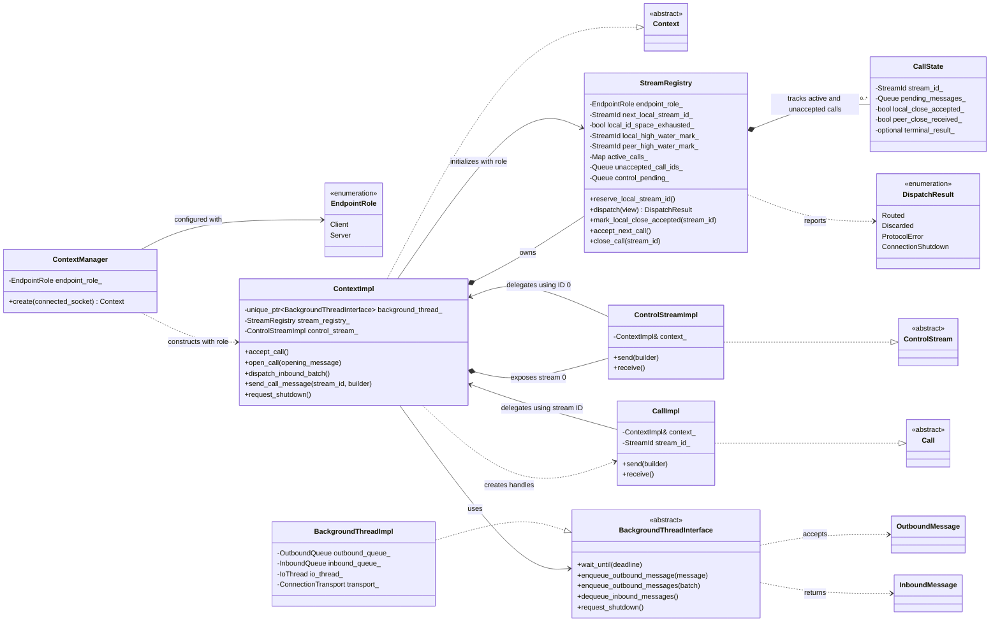

# Low-Level Context Stream Management

## Purpose and ownership

This document specifies how the low-level context manages logical streams for
one protocol-v2 connection. It complements
[context_implementation.md](context_implementation.md), which defines the
cross-thread queues and background I/O loop, and
[context_interface.md](context_interface.md), which defines the worker-facing
`Context`, `Call`, and `ControlStream` contracts.

The low-level context is the sole owner of all logical stream state. It owns
the control stream on stream ID `0`, allocates its locally owned nonzero stream
IDs, and maintains a registry from every live call stream ID to its
worker-visible `Call` state. The background component owns transport work but
does not own `Call` or `ControlStream` instances and does not dispatch to
worker-facing objects.

## Stream-ID ownership and allocation

The low-level context applies the protocol's
[stream-ownership rules](../protocol/low_level/protocol.md#stream-ownership).
The DB is the transport `Client` and UDFRunner is the transport `Server`:

- `0` is the shared control stream;
- odd nonzero IDs are owned by the `Client`;
- even nonzero IDs are owned by the `Server`;
- IDs are 64-bit and are unique for the lifetime of one connection.

Each context is created with an immutable endpoint role (`Client` or `Server`)
for the lifetime of its connection. The role determines the locally owned
stream-ID parity and validation of peer-created streams; it must not change
while the connection is active. The construction path that supplies this role
is described in
[context_implementation.md](context_implementation.md#endpoint-role-configuration).

Each endpoint reserves IDs from its own parity in strictly increasing order,
starting at `1` for a `Client` and `2` for a `Server`, and advancing each
reservation by `2`. IDs may be skipped on the wire when a reserved opening
builder is abandoned or opening fails. Exhaustion or wraparound is a local
failure, and an ID is never reused. A context allocates from the parity
assigned to its immutable endpoint role and accepts new peer streams only
from the opposite parity. Thus a `Client` context opens odd IDs and accepts
even IDs, while a `Server` context opens even IDs and accepts odd IDs. The
UDFRunner's `Server` contexts therefore use even IDs for local calls and
accept odd IDs for inbound call openings. A peer opening a stream with the
local endpoint's parity is a protocol error.

Parity determines which endpoint creates a stream, not the direction of later
traffic. Once a call exists, either peer may send permitted call messages on
that stream. In particular, UDFRunner may send responses on a DB-created odd
stream, and DB may send responses on a UDFRunner-created even stream.

## Queue messages and stream identity

Queue messages do not carry a second, separate `stream_id` field. The outbound
builder's internal message state is bound to the stream ID when the context,
call, or control stream creates it; the background thread uses that ID when it
builds the wire `Frame`. An inbound view exposes the ID from its verified
frame through `stream_id()`, and the context dispatcher uses that value to
route it. This keeps one authoritative ID in each message instead of copying
it into queue metadata.

```text
OutboundMessage = variant<unique_ptr<CallMessageBuilderBase>,
                          unique_ptr<ControlMessageBuilder>>
InboundMessage  = variant<unique_ptr<CallMessageView>,
                          unique_ptr<ControlMessageView>>
```

An outbound builder whose type does not match its bound stream ID is an
internal error. The inbound message-type and stream-ID requirements are listed
in the [validation matrix](#message-type-and-stream-id-validation).

The background component uses the ID only to encode or decode the wire message
and select connection-local transport state. It does not need access to the
context's call registry.

## Inbound dispatch

The dispatcher-to-thread wait, drain, and ownership sequence is described in
[context_implementation.md](context_implementation.md#dispatcher-interaction-with-the-background-thread).

The background thread is the only producer of the physical inbound queue. It
appends messages in the order in which complete protocol messages are accepted
from the socket. It does not call worker code and does not block for a
particular call.

The low-level context's dispatcher is the only consumer of that queue. It
drains a batch and obtains each message's stream ID from its view. For every
message, it applies these checks in order:

### Message-type and stream-ID validation

| Inbound message | Valid stream ID | Additional restriction |
| --- | --- | --- |
| `ControlMessageView` | Exactly `0` | A control view on a nonzero stream is a protocol error. |
| `CallMessageView` | Any nonzero ID | A call view on stream `0` is a protocol error. |
| `CloseConnection` | `0`, inside a `ControlMessageView` | It is invalid in a call message or on a nonzero stream. |
| `OpenCall` | Nonzero, inside a `CallMessageView` | It is valid only as the first message on a newly created peer-owned stream. |

The view-to-stream mismatches in this table are protocol errors, including a
`CallMessageView` on stream `0` and a `ControlMessageView` on a nonzero stream.

1. **Validate the stream ID and ownership parity.** Stream `0` is reserved for
   control traffic. For a nonzero ID, parity identifies the endpoint that
   created the stream. An active stream may carry traffic in either direction.
   An inactive ID with local-endpoint parity is invalid inbound ownership and
   must fail with a protocol error before consulting either high-water mark.
2. **Validate message kind.** Apply the view-type, stream-ID, and
   control-only-field rules in the matrix above. Check the state-dependent
   `OpenCall` restriction in step 3. For example, a `Server` receiving a call
   view from the `Client` on inactive stream `2` fails with a protocol error at
   step 1, even if its local high-water mark is already `2` or higher.
3. **Check active state and peer high-water mark.** If an active call has
   already received `close_call`, discard subsequent call views. Otherwise, an
   active call accepts the view except that `open_call` after the stream's
   first message is a protocol error. Enqueue a valid view containing
   `close_call` and mark that the peer close was received. A local outbound
   close does not stop the context from receiving already-in-flight peer
   messages. For an inactive peer-owned stream, an ID
   at or below the peer high-water mark is delayed traffic and is discarded,
   except that `open_call` there is an attempt to reuse an ID and is a protocol
   error. An ID above the peer high-water mark can create a stream only with a
   valid first `open_call`; other unknown-stream traffic is a protocol error.
   These high-water rules apply only after step 1 has established that the
   inactive ID has peer-owned parity.
4. **Route, discard, or fail.** Stream `0` messages go to the control-stream
   pending list. Active call messages go to that call's pending list. A valid
   peer opening creates an inbound-call entry in the unaccepted-call list.
   Delayed messages are discarded; any protocol error fails the connection.

A message for a call that has not yet been accepted remains with that stream
entry and is not returned by another call. `close_connection` is handled as a
context shutdown event rather than being placed in the control-stream pending
list.

### Call close ordering

When a `CallMessageView` contains `close_call`, the dispatcher appends the
complete view to that call's pending sequence and marks `peer_close_received`.
It discards subsequent call views for that stream, including later views in
the same drained batch, while preserving messages already queued before the
close-bearing view. This also applies when the opening view contains both
`open_call` and `close_call`: the stream remains in the unaccepted-call order,
and `accept_call()` still returns its `Call` handle.

After a local close is accepted, inbound messages continue to be routed until
a peer close is received. `Call::receive()` returns those messages in FIFO
order; when it returns the peer's close-bearing view, the `Call` becomes closed
and the registry releases the stream state and pending sequence. If no peer
close arrives, this state remains pending across receive timeouts until
cancellation or connection termination. Worker-facing send and receive
results are defined in
[context_interface.md](context_interface.md#closecall-delivery-and-receive-ordering).

`accept_call()` removes the next entry from the unaccepted-call list and
returns a `Call` bound to its `stream_id`. Its already received opening message
remains at the head of that call's pending list. `Call::receive()` and
`ControlStream::receive()` first inspect their pending list, then drain and
route a shared inbound batch, and only then wait. This provides stream-local
consumer semantics while retaining one shared inbound queue.

The dispatcher preserves FIFO order within every stream. Messages for distinct
streams may be interleaved in the physical queue and must not make an unrelated
`receive()` return. A global readiness query is true when either the shared
inbound queue or any context-owned pending list contains an unread message.

## Outbound routing

`open_call()` reserves the next locally owned stream ID, creates and registers
the `Call` state, and enqueues the opening builder, which is already bound to
that ID. It rolls back the registration if enqueue fails; the reserved ID is
still not reused.

`Call::send()` creates a builder bound to its context-managed call ID and
enqueues it. `ControlStream` creates builders bound to ID `0`; neither
worker-facing abstraction exposes numeric IDs to worker code. Outbound
`close_call` acceptance and its send-side state transition are defined in the
[worker-facing contract](context_interface.md#outbound-closecall).
An accepted `open_call()` opening message that also contains `close_call`
initializes the call with its local send side already closed.

## Close and ID lifetime

The context keeps an active-call registry and one high-water mark for each
endpoint role. The local high-water mark advances when a stream ID is reserved;
the peer high-water mark advances when a valid opening is admitted to the
context's unaccepted-call list. An accepted local `CloseCall` marks the state
`ClosePending` and seals outbound sends but retains the stream for inbound
traffic until the peer close is received. On peer `CloseCall`, the context
retains the state until the terminal view is returned, then releases its active
state and pending messages without changing either high-water mark. An
inbound message on an inactive local-owned ID is a protocol error, including
when the ID is below the local high-water mark. Delayed traffic on a non-active
peer-owned ID at or below the peer high-water mark is discarded. No
per-closed-stream ID set is needed, and monotonic allocation prevents a closed
ID from being reused.

Connection close transitions every live stream to its terminal result and wakes
its waiters.

## Implementation sketches

The following pseudocode illustrates how the context can implement the rules
above. The container types and error-reporting API are illustrative; the
requirements in the preceding sections remain authoritative.

### Proposed class design

This sketch separates the worker-facing context, its logical stream state, and
the background-thread boundary. The class names and method placement are
proposals; the ownership and behavior specified above are normative.



`StreamRegistry` owns logical stream IDs, high-water marks, per-call pending
messages, the unaccepted-call order, and control-stream pending messages. A
`CallImpl` is a lightweight worker-facing handle: it delegates through
`ContextImpl` using its ID, while `StreamRegistry` owns its `CallState` before
and after `accept_call()`. `BackgroundThreadImpl` is the production adapter;
tests can provide another implementation of `BackgroundThreadInterface`.

Reserve a local ID before creating the opening builder. Once reserved, the ID
and local high-water mark stay consumed even if builder creation or enqueueing
fails:

```text
StreamRegistry::reserve_local_stream_id():
    if local_id_space_exhausted:
        return local_failure

    id = next_local_stream_id
    local_high_water_mark = id
    if id > UINT64_MAX - 2:
        local_id_space_exhausted = true
    else:
        next_local_stream_id = id + 2
    return id
```

The dispatcher first validates ownership parity for an inactive nonzero ID,
then validates the message/view combination, and only then checks stream state
and the peer high-water mark. Its decision flow can be sketched as:

```text
StreamRegistry::dispatch(view):
    id = view.stream_id()
    active = active_calls.contains(id)

    if id != 0 and not active and has_local_endpoint_parity(id):
        return ProtocolError

    if not matches_view_type_and_stream_id_rules(view, id):
        return ProtocolError

    if id == 0:
        if view.contains_close_connection():
            return ConnectionShutdown
        else:
            control_pending.push(view)
        return Routed

    if active:
        if active_calls[id].peer_close_received:
            discard(view)  // after CloseCall, including the rest of this batch
            return Discarded
        if view.contains_open_call():
            return ProtocolError
        active_calls[id].pending.push(view)
        if view.contains_close_call():
            active_calls[id].peer_close_received = true
        return Routed

    if id <= peer_high_water_mark:
        if view.contains_open_call():
            return ProtocolError  // stream ID reuse
        discard(view)              // delayed peer-owned traffic
        return Discarded

    if not view.contains_open_call():
        return ProtocolError

    peer_high_water_mark = id
    active_calls[id] = CallState(
        pending = [view],
        local_close_accepted = false,
        peer_close_received = view.contains_close_call())
    unaccepted_call_ids.push(id)
    return Routed
```

### Background-thread handoff

The `BackgroundThreadInterface` methods, ownership results, and wait events
are defined in
[context_implementation.md](context_implementation.md#low-level-context-boundary).
These sketches show where the stream registry participates in that handoff.

The context drains complete inbound batches and applies the dispatcher above;
the background thread does not inspect the registry or route to worker calls:

```text
ContextImpl::dispatch_inbound_batch():
    for view in background_thread.dequeue_inbound_messages():
        outcome = stream_registry.dispatch(view)
        if outcome == ProtocolError:
            fail_connection_and_request_background_shutdown()
            return
        if outcome == ConnectionShutdown:
            publish_terminal_result_and_request_background_shutdown()
            return
```

For a blocking receive, the context checks the requested stream's pending list,
drains and dispatches a batch, and calls `wait_until(deadline)` only if the
list and inbound queue are empty. `InboundAvailable` restarts the drain;
`ShutdownRequested` publishes the terminal result; `DeadlineExpired` returns a
timeout. The complete receive-loop and notification-race behavior is described
in [context_implementation.md](context_implementation.md#dispatcher-interaction-with-the-background-thread).

An outbound builder already carries the ID assigned by its context object. A
successful enqueue accepts the logical message, not confirmation that the
socket has received it:

```text
ContextImpl::send_call_message(stream_id, caller_builder&&):
    dispatch_available_inbound_messages()
    state = stream_registry.find(stream_id)
    if state.peer_close_received:
        return PeerClosed
    if state.local_close_accepted:
        return ProtocolError

    closes_call = caller_builder.contains_close_call()
    validate caller_builder is bound to stream_id
    message = wrap_as_outbound_message(move(caller_builder))
    if not background_thread.enqueue_outbound_message(message):
        // false leaves message unchanged; recover the builder for the caller.
        caller_builder = extract_call_builder(move(message))
        return enqueue_failure

    if closes_call:
        stream_registry.mark_local_close_accepted(stream_id)
    return accepted
```

The close state and queue-acceptance result form one worker-visible acceptance
transaction. The single worker thread cannot interleave another `Call::send()`
between successful enqueue and the `local_close_accepted` update. Since the
outbound queue is FIFO, all messages accepted before the close remain ahead of
it; the state update rejects every later send.

The production background component consumes accepted messages, uses each
builder's bound stream ID when encoding its wire frame, and writes frames using
its connection-owned transport state. In the other direction, it decodes
complete frames into verified views, appends those views to the inbound queue,
and signals `InboundAvailable`. This component-level flow is illustrative;
the low-level context remains responsible for stream validation and routing.

When a call closes, remove its active state and pending sequence without
changing either high-water mark. This preserves the distinction between an
inactive local-owned ID, which is an error, and delayed traffic for an
inactive peer-owned ID, which is handled by the dispatch flow above.

## Invariants

This design retains exactly two cross-thread queues: one worker-to-background
outbound queue and one background-to-worker inbound queue. The call registry,
unaccepted-call list, per-role high-water marks, and per-stream pending
messages are low-level-context-owned dispatch state, not background-thread
queues.
